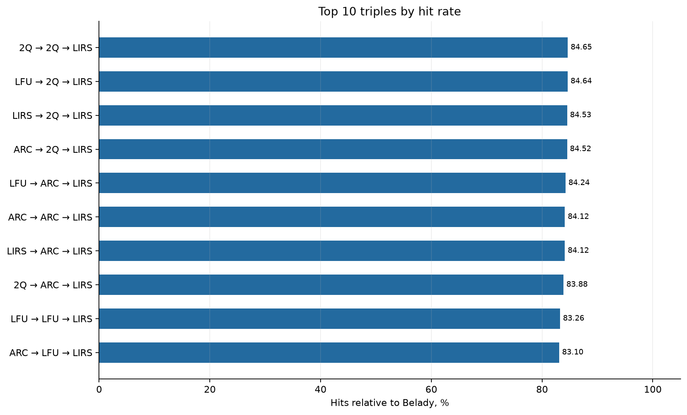
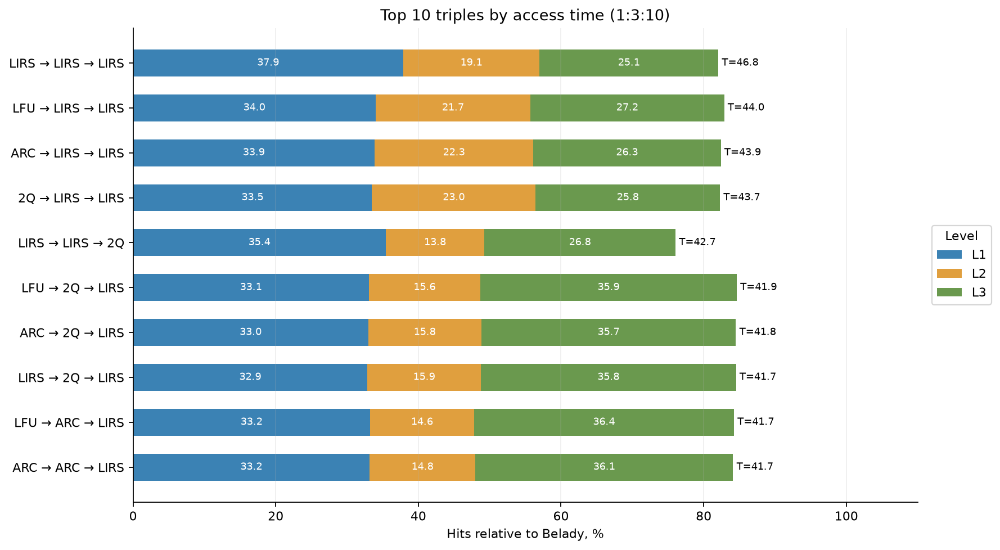
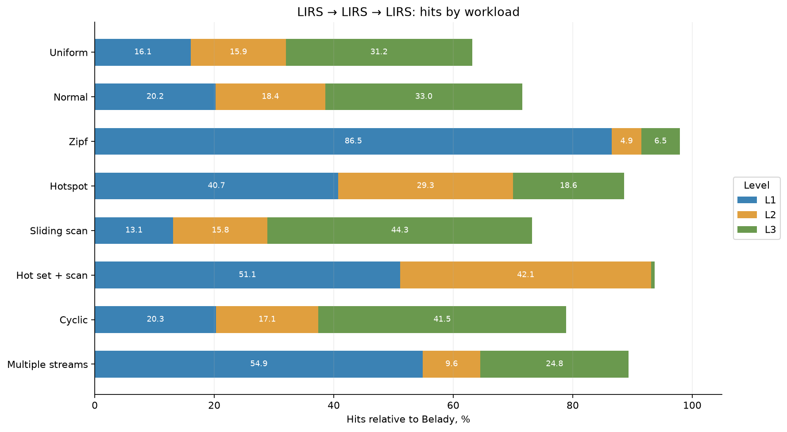
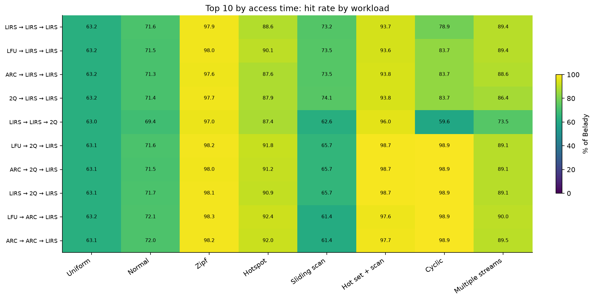

<h1 align="center">Cache research</h1>

<p align="center">
  Comparing cache replacement policies in an inclusive three-level cache hierarchy
</p>

<p align="center">
  
  
  
</p>

---

The project implements four cache replacement policies — LFU, 2Q, ARC and LIRS — and combines them into an inclusive multi-level cache hierarchy. The command-line program runs a request sequence through a hierarchy described in a config file and prints the number of hits. A separate research pipeline compares every three-level combination of the policies against the ideal Belady cache.

- Each level of the hierarchy can use any of the four policies and its own capacity.
- The hierarchy is inclusive: a key evicted from a lower level is invalidated on every level above it.
- The Belady cache knows the whole request sequence in advance and serves as an upper bound on hits.
- The research compares all 64 ordered triples of policies on 8 workloads, both by total hits and by access time.

## Contents

- [Getting started](#getting-started)
- [Usage](#usage)
- [Cache replacement policies](#cache-replacement-policies)
  - [LFU](#lfu-least-frequently-used)
  - [2Q](#2q-two-queues)
  - [ARC](#arc-adaptive-replacement-cache)
  - [LIRS](#lirs-low-inter-reference-recency-set)
  - [Belady](#belady-ideal-cache)
- [Inclusive hierarchy](#inclusive-hierarchy)
  - [Request handling](#request-handling)
  - [Filling the levels](#filling-the-levels)
  - [Eviction and invalidation](#eviction-and-invalidation)
- [Research](#research)
  - [Setup](#setup)
  - [Hit-rate ranking](#hit-rate-ranking)
  - [Access-time ranking](#access-time-ranking)
  - [Per-workload results](#per-workload-results)
  - [Conclusions](#conclusions)
  - [Reproducing the research](#reproducing-the-research)
- [Testing](#testing)
- [Project layout](#project-layout)

## Getting started

> [!NOTE]
> The build and tests are verified on Windows ([MSYS2](https://www.msys2.org/) UCRT64) and Linux (Ubuntu 24.04).

Requirements:

| Tool | Version | Used for |
|---|---|---|
| GCC | C++20 support | building |
| [CMake](https://cmake.org/) | 3.16+ | building, fetching GoogleTest |
| Python | 3.10+ | the research pipeline |
| matplotlib, NumPy | any | research figures |

GoogleTest is fetched automatically on the first configure.

```bash
git clone https://github.com/andreyphm/Cache_research.git
cd Cache_research
```

### Windows (MSYS2 UCRT64)

Install the toolchain from an MSYS2 UCRT64 terminal:

```bash
pacman -S mingw-w64-ucrt-x86_64-gcc mingw-w64-ucrt-x86_64-cmake mingw-w64-ucrt-x86_64-ninja
```

Build:

```bash
cmake -S . -B build
cmake --build build
```

### Linux (Ubuntu)

Install the toolchain:

```bash
sudo apt install -y build-essential cmake git
```

Build:

```bash
cmake -S . -B build
cmake --build build
```

## Usage

The program takes the path to a config file as its only argument and reads the requests from standard input.

### Windows

```powershell
cmd /c ".\build\cache_research.out.exe config.txt < input.txt"
```

> [!TIP]
> PowerShell has no `<` input redirection, so the program is launched through `cmd /c`. In an MSYS2 terminal the usual syntax works: `./build/cache_research.out config.txt < input.txt`.

### Linux

```bash
./build/cache_research.out config.txt < input.txt
```

### Config format

The first number is the level count. It is followed by one policy name per level, from the top level (L1) down: `LFU`, `ARC`, `2Q` or `LIRS`.

```text
2
LFU ARC
```

### Input format

Standard input holds one capacity per level from the top level down, then the request count, then the requests. Capacities must be positive and must not decrease from top to bottom.

```text
2 4 4
1 2 1 2
```

Here L1 holds 2 keys, L2 holds 4 keys, and there are 4 requests.

### Output format

The program prints the total number of hits across all levels. In the example above the first two requests miss and load keys `1` and `2` into both levels, and the last two requests hit L1:

```text
2
```

On invalid input — a wrong argument count, an unreadable config, an unknown policy, a non-positive or decreasing capacity, fewer requests than announced — the program prints a message to stderr and exits with code `1`.

## Cache replacement policies

Every policy below keeps its entries in linked lists and finds keys through a hash table. Some policies also keep **ghost entries** — keys of recently evicted entries without their data. A ghost entry does not take up capacity and does not count as a hit, but it tells the policy that a key has been seen before.

### LFU (Least Frequently Used)

Implementation: [`headers/LFU_cache.hpp`](headers/LFU_cache.hpp).

Each entry counts its accesses. The entries are kept sorted by this count, and among entries with the same count the most recently used one comes first. A hit increments the count and moves the entry to its new place. When the cache is full, the entry with the lowest count is evicted; on a tie, the one used least recently.

### 2Q (Two Queues)

Implementation: [`headers/2Q_cache.hpp`](headers/2Q_cache.hpp).

2Q separates keys seen once from keys that are reused:

- **`A1in`** — a FIFO queue of new entries. A hit here does not change the order.
- **`A1out`** — ghost entries of keys evicted from `A1in`.
- **`Am`** — an LRU queue of reused entries. A hit moves the entry to the front.

A new key goes to `A1in`. A key found in `A1out` has been requested again soon after eviction, so it goes straight to `Am`. When the cache is full, the oldest entry of `A1in` is moved to `A1out` if `A1in` is larger than a quarter of the capacity; otherwise the least recently used entry of `Am` is evicted.

### ARC (Adaptive Replacement Cache)

Implementation: [`headers/ARC_cache.hpp`](headers/ARC_cache.hpp).

ARC splits the cache into two lists and adapts the split to the workload:

- **`T1`** — entries accessed once recently;
- **`T2`** — entries accessed at least twice;
- **`B1`**, **`B2`** — ghost entries of keys evicted from `T1` and `T2`.

A hit in `T1` or `T2` moves the entry to the front of `T2`. A new key goes to `T1`. ARC keeps a target size for `T1`, starting at half the capacity. When a full cache needs space, it evicts from `T1` if `T1` is above the target and from `T2` otherwise; the evicted key goes to the matching ghost list.

A request for a ghost key shows which list was too small. A key found in `B1` means `T1` should have been larger, so the target grows by one; a key found in `B2` means the same for `T2`, so the target shrinks by one. In both cases the key returns to `T2`. The ghost lists are bounded so that `T1` and `B1` together hold at most `capacity` keys, and all four lists at most `2 × capacity`.

### LIRS (Low Inter-reference Recency Set)

Implementation: [`headers/LIRS_cache.hpp`](headers/LIRS_cache.hpp).

LIRS ranks keys by how short the gap between their last two accesses is. Keys with a short gap form the **LIR** set and are protected from eviction. All other keys form the **HIR** set, and eviction candidates come only from there. LIR takes 99% of the capacity, and HIR uses the rest.

- **Stack `S`** holds keys in recency order: all LIR keys and HIR keys seen recently, including ghost entries. The bottom of `S` is always a LIR key; HIR keys below it are pruned.
- **Queue `Q`** holds the HIR entries with data. The cache evicts from the end of `Q`.

When a HIR key is accessed while it is still in `S`, its gap is shorter than that of the oldest LIR key. The key becomes LIR, and the LIR key at the bottom of `S` becomes HIR and moves to `Q`. A HIR key that is no longer in `S` stays HIR and only moves to the front of `Q` and `S`. A ghost key found in `S` is reloaded and becomes LIR the same way.

### Belady (Ideal cache)

Implementation: [`headers/belady_cache.hpp`](headers/belady_cache.hpp).

Belady's algorithm is the optimal policy, but it requires knowing the future. It receives the whole request sequence in advance and, for every cached key, tracks the position of its next request. When the cache is full, it evicts the key that will be needed latest, or one that will never be needed again. No other policy with the same capacity gets more hits on the same sequence, so the research measures every hierarchy against it.

## Inclusive hierarchy

Implementation: [`source/cache_runner.cpp`](source/cache_runner.cpp).

The hierarchy is a sequence of levels from the top (L1) to the bottom. The config sets the number of levels, and each level gets its own policy and capacity. The levels are inclusive: every key held by a level is also held by all levels below it. That is why capacities must not decrease from top to bottom, and the bottom capacity limits the number of distinct keys in the whole hierarchy.

> [!NOTE]
> The Belady cache serves only as a reference and is not part of the hierarchy.

### Request handling

A request goes to L1 first. On a miss it goes down to L2, then L3, and finally to the storage. The hit is counted on the first level that has the key, and only there. So the total hit count of the hierarchy equals the sum of the per-level hits, and a request that misses every level is a total miss.

### Filling the levels

The data goes back up along the same path, and every level that missed stores a copy:

- an L2 hit inserts the key into L1;
- an L3 hit inserts it into L2 and L1;
- a load from the storage inserts it into every level.

If a level has to make space, it chooses a victim by its own policy. The levels share no policy state: LFU counts, ARC and 2Q lists, and LIRS sets of one level do not affect another.

### Eviction and invalidation

Evicting a key from an upper level does not change the levels below. After L1 evicts a key, L2 and L3 may still hold it, and a later request can hit there and refill L1.

Evicting a key from a lower level invalidates it on every level above. If L3 evicts a key, its copies in L2 and L1 are removed at once; if L2 evicts a key, the L1 copy is removed and the L3 copy stays. This keeps the hierarchy inclusive after any eviction. Ghost entries are not copies of the data, so invalidation does not apply to them.

A lower level sees only the requests that missed every level above it. An L1 hit does not update the access count or recency of the same key in L2 and L3. So a key can be popular in L1 but old or rare in L3, and when L3 evicts it, the L1 copy is invalidated anyway. This interplay of independent policies and cascading invalidation is what the research explores.

## Research

### Setup

The research compares all 64 ordered triples of LFU, ARC, 2Q and LIRS, repetitions included. The levels have capacities C, 2C and 4C, where C is 64, 256 or 1,024. The reference is a single Belady cache with capacity 4C. Each trace has 120C requests: 7,680, 30,720 or 122,880. The caches start empty, and every request counts.

The main score is the share of Belady's hits:

$$
\mathrm{score} = 100 \times \frac{\mathrm{hits}}{\mathrm{belady\_hits}}
$$

In the table below, W is the number of keys a workload draws from.

| Workload | Parameters |
|---|---|
| Uniform | independent requests to W = 8C keys |
| Normal | W = 8C, mean 4C, standard deviation 2C; out-of-range values are redrawn |
| Zipf | W = 8C, rank r has weight 1/r^1.2 |
| Hotspot | W = 8C; 80% of requests go to H = 2C hot keys |
| Sliding scan | sequential windows of 6C keys shifted by 1.5C; neighboring windows overlap by 4.5C |
| Hot set + scan | 4C requests to H = 2C hot keys, then a pass over 4C new keys |
| Cyclic | a sequential pass over W = 6C keys, repeated 20 times |
| Multiple streams | Zipf (α = 1), a cyclic pass and Hotspot (p = 0.9) over separate sets of 4C keys, mixed 1:1:1 |

Sliding scan and cyclic are deterministic and run once. The other workloads use seeds 1–5. All triples and Belady get the same trace for a given workload, capacity and seed. In total there are 96 traces and 6,144 hierarchy runs.

The ranking averages over seeds, then over the three capacities, then over the eight workloads.

### Hit-rate ranking

**2Q → 2Q → LIRS** comes first with 84.65% of Belady's hits. LFU → 2Q → LIRS is second with 84.64%, only 0.01 percentage points behind.



### Access-time ranking

This ranking assumes the access times of L1, L2 and L3 are in the ratio 1:3:10, so hits on faster levels weigh more:

$$
T = 100 \times \frac{\mathrm{L1\_hits} + \mathrm{L2\_hits} / 3 + \mathrm{L3\_hits} / 10}{\mathrm{belady\_hits}}
$$

The triples are sorted by `T`, shown on the right. The colored segments show the L1, L2 and L3 hits relative to Belady; together they add up to the total hit rate of the hierarchy.



The breakdown of hits for the winner, **LIRS → LIRS → LIRS**, on each workload:



### Per-workload results

The rows are the top 10 triples of the access-time ranking. Each cell is the total hit rate relative to Belady on one workload.



### Conclusions

**By total hits**, 2Q → 2Q → LIRS and LFU → 2Q → LIRS are practically tied: the 0.01-point gap is smaller than the spread between seeds. The top four triples all have 2Q in L2 and LIRS in L3 and differ only in L1, and all top 10 have LIRS in L3. So the lower levels decide the total: LIRS keeps the data that reaches L3, and 2Q in L2 separates reused keys from one-time and sequential requests.

**By access time**, LIRS → LIRS → LIRS wins with T = 46.75, ahead of LFU → LIRS → LIRS with T = 43.95. Yet it is only 16th by total hits, with 82.05%, while 2Q → 2Q → LIRS is only 17th by access time, with T = 41.32. The reason is where the hits happen:

| Triple | L1 | L2 | L3 | Total |
|---|---:|---:|---:|---:|
| LIRS → LIRS → LIRS | 37.87% | 19.12% | 25.06% | 82.05% |
| 2Q → 2Q → LIRS | 32.24% | 16.49% | 35.92% | 84.65% |

2Q → 2Q → LIRS gets more hits, but a much larger share of them comes from the slow L3. LIRS → LIRS → 2Q shows the difference between the two criteria even more clearly: it is 32nd of 64 by total hits with 76.05%, but 5th by access time with T = 42.72.

### Reproducing the research

Install the plotting libraries, then configure in Release mode and build the `research` target:

```bash
python -m pip install matplotlib numpy
cmake -S . -B build -DCMAKE_BUILD_TYPE=Release
cmake --build build --config Release --target research
```

The target builds the trace runner, generates the traces, compares the 64 triples against Belady and draws the figures. It is available only if CMake finds Python 3.10 or newer; pass `-DPython3_EXECUTABLE=...` to point it to a specific interpreter. Running it again replaces the previous results.

The research parameters live in [`benchmarks/scripts/suite.json`](benchmarks/scripts/suite.json). The scripts can also be run by hand:

- [`generators.py`](benchmarks/scripts/generators.py) generates the traces;
- [`run.py`](benchmarks/scripts/run.py) runs the C++ trace runner and saves the raw results;
- [`report.py`](benchmarks/scripts/report.py) aggregates them into CSV summaries and PNG figures.

| Script | Argument | Meaning |
|---|---|---|
| `run.py` | `--binary` | path to the built `cache_benchmark.out`, required |
| `run.py` | `--suite` | research parameters, `scripts/suite.json` by default |
| `run.py` | `--output` | results directory, `benchmarks/results` by default |
| `run.py` | `--data` | traces directory, `benchmarks/data` by default |
| `run.py` | `--jobs` | number of concurrent C++ processes, `2` by default |
| `run.py` | `--families` | run only the named workloads |
| `run.py` | `--rerun` | replace the existing results with a new experiment |
| `report.py` | `--results` | results directory to read, `benchmarks/results` by default |

Figures are saved to `benchmarks/results/figures`. To keep a separate experiment, pass its own directories: `run.py --output <dir> --data <dir>`, then `report.py --results <dir>`.

## Testing

The tests use [GoogleTest 1.17.0](https://google.github.io/googletest/) and run through [CTest](https://cmake.org/cmake/help/latest/manual/ctest.1.html). They are built together with the project; the configuration is in [`tests/CMakeLists.txt`](tests/CMakeLists.txt).

Run all tests from the project root:

```bash
ctest --test-dir build --output-on-failure
```

Run one group by its label:

```bash
ctest --test-dir build -L LIRS --output-on-failure
```

| Label | What is tested |
|---|---|
| `LFU`, `2Q`, `ARC`, `LIRS` | the policy on its own |
| `belady` | the Belady cache |
| `interface` | config parsing and the hierarchy |

> [!NOTE]
> `--test-dir` requires CTest 3.20 or newer. With CTest 3.16–3.19, run the same commands from the build directory: `(cd build && ctest --output-on-failure)`.

## Project layout

```text
Cache_research/
├── headers/
│   ├── 2Q_cache.hpp                              # 2Q cache
│   ├── ARC_cache.hpp                             # ARC cache
│   ├── LFU_cache.hpp                             # LFU cache
│   ├── LIRS_cache.hpp                            # LIRS cache
│   ├── belady_cache.hpp                          # Belady cache
│   ├── SlowGetPage.hpp                           # storage behind the bottom level
│   ├── benchmark_runner.hpp                      # running one research trace
│   ├── cache_runner.hpp                          # multi-level hierarchy
│   └── config.hpp                                # config parsing
├── source/
│   ├── benchmark_main.cpp                        # trace runner entry point
│   ├── benchmark_runner.cpp                      # all 64 triples and Belady on one trace
│   ├── cache_runner.cpp                          # multi-level hierarchy
│   ├── config.cpp                                # config parsing
│   └── main.cpp                                  # command-line program
├── tests/
│   ├── 2Q_tests.cpp                              # 2Q tests
│   ├── ARC_tests.cpp                             # ARC tests
│   ├── LFU_tests.cpp                             # LFU tests
│   ├── LIRS_tests.cpp                            # LIRS tests
│   ├── belady_tests.cpp                          # Belady tests
│   ├── interface_tests.cpp                       # config and hierarchy tests
│   └── CMakeLists.txt                            # building and registering the tests
├── benchmarks/
│   ├── figures/
│   │   ├── ranking_belady.png                    # hit-rate ranking
│   │   ├── ranking_access_time_levels.png        # access-time ranking
│   │   ├── best_access_time_workload_levels.png  # winner hits by workload
│   │   └── workloads.png                         # top 10 by workload
│   └── scripts/
│       ├── generators.py                         # trace generation
│       ├── run.py                                # running the experiment
│       ├── report.py                             # CSV summaries and figures
│       └── suite.json                            # research parameters
├── .gitignore
├── CMakeLists.txt                                # building the program, tests and research target
└── README.md
```
